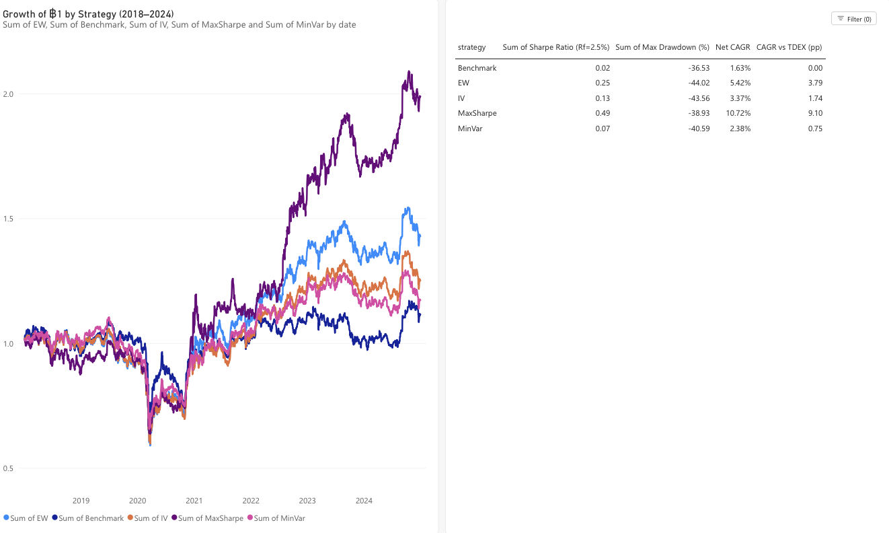
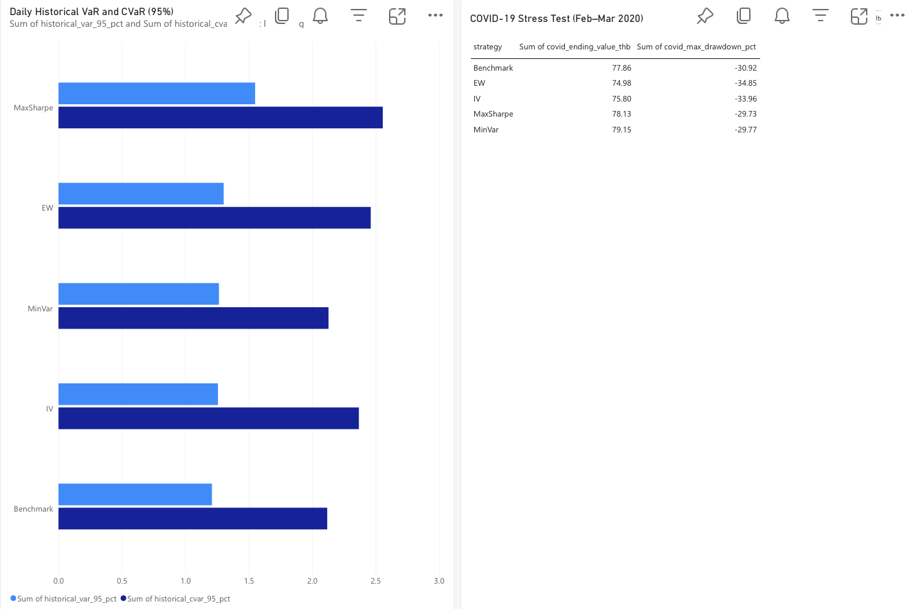
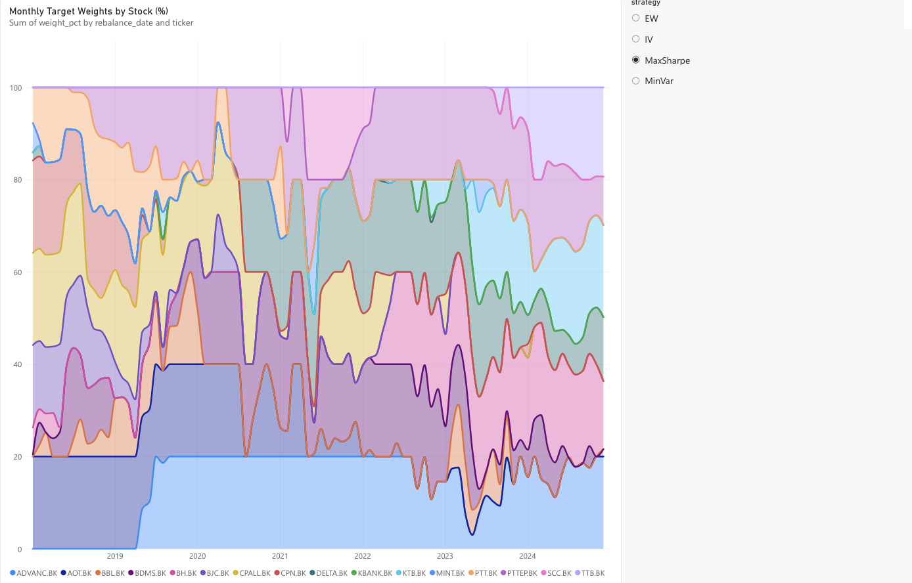

# Thai Equity Portfolio Backtest & Risk Dashboard

A Python and Power BI project comparing four portfolio allocation strategies on 16 Thai equities. It tests monthly rebalancing after transaction costs, measures downside risk, and evaluates whether five-day volatility forecasts improve portfolio decisions.

## Backtest design

- **Data.** Daily adjusted close prices from Yahoo Finance for 16 Thai equities and the ThaiDEX SET50 ETF (`TDEX.BK`). The local SQLite dataset covers 2015–2024. TDEX.BK is the benchmark.
- **Allocation.** Equal Weight, Inverse Volatility, Minimum Variance, and Maximum Sharpe. The two optimizers are long-only and cap each stock at 20%.
- **Walk-forward evaluation.** Each month uses the prior 36 calendar months to estimate target weights. The out-of-sample backtest covers **3 January 2018 through 30 December 2024**, with **1,700 trading days and 84 monthly rebalances**.
- **Costs and metrics.** The simulation charges 15 basis points times turnover at each rebalance. CAGR is compounded using a 252-trading-day convention. Sharpe uses an assumed annual risk-free rate of 2.5%.

## Backtest results after transaction costs

| Strategy | Net CAGR | Annualized volatility | Sharpe | Max drawdown | Annualized turnover |
| --- | ---: | ---: | ---: | ---: | ---: |
| Equal Weight | 5.42% | 17.48% | 0.25 | −44.02% | 7.14% |
| Inverse Volatility | 3.37% | 16.84% | 0.13 | −43.56% | 13.72% |
| Minimum Variance | 2.38% | 15.17% | 0.07 | −40.59% | 49.75% |
| Maximum Sharpe | 10.72% | 19.50% | 0.49 | −38.93% | 122.70% |
| TDEX.BK benchmark | 1.63% | 15.37% | 0.02 | −36.53% | — |

Maximum Sharpe had the highest net CAGR and the highest annualized volatility and turnover among the four strategies in this sample. Its CAGR was **10.94% before costs** and **10.72% after costs**. [Backtest notebook](notebooks/04_walk_forward_backtest.ipynb) · [Results CSV](outputs/backtest_summary.csv)

## Risk and forecasting

- **Tail risk and stress test.** Equal Weight had a one-day 95% historical VaR of **1.30%** and a CVaR of **2.46%**, the average loss across its 85 worst days. During the February–March 2020 stress window, ฿100 fell to **฿74.98** at the end of the window, with a **−34.85%** maximum drawdown along the way. [Risk notebook](notebooks/06_risk_and_scenarios.ipynb) · [Risk metrics by strategy](outputs/risk_summary.csv)
- **Sharpe uncertainty.** Equal Weight’s observed Sharpe exceeded TDEX.BK’s by **0.2274**. A paired moving-block bootstrap with 2,000 samples and 20-trading-day blocks gave a 95% interval of **[−0.0565, 0.5583]**, which includes zero. [Bootstrap analysis](notebooks/06_risk_and_scenarios.ipynb)
- **Five-day volatility forecasting.** The study uses 2017 for validation and 2018–2024 for testing, with monthly expanding-window refits and training labels restricted to outcomes known before each fold. On **1,695 scored test days**, GARCH had the lowest QLIKE (**0.5639**), followed by EWMA (**0.6073**). LightGBM scored **0.8416** and the PyTorch LSTM **0.9249**. The LSTM also predicted the probability of a positive five-day return. Its directional accuracy was **47.55%** versus **50.15%** for always predicting up, with a 95% interval for the difference that includes zero. [Forecasting notebook](notebooks/05_volatility_forecasting.ipynb)
- **Portfolio use.** Relative to fully invested Equal Weight, LSTM volatility targeting reduced the magnitude of maximum drawdown by **20.81 percentage points** and net CAGR by **3.50 points**. Historical-volatility targeting reduced drawdown by **23.66 points** and net CAGR by **4.01 points** under the same rules. [Portfolio evaluation](notebooks/05_volatility_forecasting.ipynb)

## Power BI report

### Performance

Growth of ฿1 for each strategy and TDEX.BK, with a table of net CAGR, excess CAGR versus TDEX.BK, Sharpe, and maximum drawdown.



### Risk

Historical VaR and CVaR by strategy, alongside ending portfolio values and maximum drawdowns during the COVID-19 stress window.



### Holdings

Monthly target weight by stock, with a single-select strategy slicer.



## Reproduce the analysis

From the repository root, create a Python 3.12 environment and start Jupyter in the notebook directory. SQLite is available through Python’s standard library.

```sh
python3.12 -m venv .venv
source .venv/bin/activate
python -m pip install jupyterlab pandas numpy scipy matplotlib yfinance
python -m pip install arch lightgbm torch scikit-learn
mkdir -p data
cd notebooks
jupyter lab
```

1. Run [01_data_pipeline.ipynb](notebooks/01_data_pipeline.ipynb) to download prices and create `data/prices.db`. The database is generated locally and excluded from Git.
2. Run [02_exploratory_risk.ipynb](notebooks/02_exploratory_risk.ipynb) and [03_portfolio_construction.ipynb](notebooks/03_portfolio_construction.ipynb) to review the exploratory analysis and allocation methods.
3. Run [04_walk_forward_backtest.ipynb](notebooks/04_walk_forward_backtest.ipynb) to generate the [performance summary](outputs/backtest_summary.csv), [equity curves](outputs/equity_curves.csv), and [monthly target weights](outputs/holdings_weights.csv).
4. Run [05_volatility_forecasting.ipynb](notebooks/05_volatility_forecasting.ipynb) for the forecast comparisons and portfolio experiments. LightGBM requires an OpenMP runtime on macOS.
5. Run [06_risk_and_scenarios.ipynb](notebooks/06_risk_and_scenarios.ipynb) to calculate tail risk, stress-test results, and the Sharpe interval. It reads the equity curves from step 3 and generates the [risk summary](outputs/risk_summary.csv).

The Power BI report uses the four generated CSVs. The screenshots above show the saved report.

## Limitations

- The stock universe is fixed across the study. Selecting stocks with available historical coverage may introduce survivorship bias.
- The price pipeline forward-fills gaps and backfills any remaining leading gaps. Backfilling can introduce future information for affected observations. Fresh downloads may also differ from the original data snapshot.
- The simulation applies fixed monthly target weights to daily returns and computes turnover from changes between targets. It simplifies weight drift, trade execution, and costs. The cost model uses a flat rate and does not include slippage or market impact.
- The forecasting portfolio experiments use a five-day forecast to set monthly exposure and assume a zero return on cash. Holding cash can reduce drawdown on its own. The observed reductions do not establish that LSTM adds value over a simpler allocation rule.
